# rpa-quote-automation

## 운영 기능
- 데이터 오류와 메일 발송 실패를 나눠서 기록
- 메일 발송 오류가 나도 다음 건을 계속 처리
- 실행 로그: 시작·종료 시각, PDF·발송·실패 건수

## As-Is / To-Be

```mermaid
flowchart TD
    subgraph ASIS["As-Is: 주문마다 손으로 반복"]
        A1["엑셀 파일 찾기 (첫 건만)"] --> A2["엑셀에서 주문 확인"]
        A2 --> A3["Word 양식 파일 찾기 (첫 건만)"]
        A3 --> A4["양식 복사 후 8칸 입력"]
        A4 --> A5["PDF로 저장"]
        A5 --> A6["메일 작성, PDF 첨부 후 발송"]
        A6 --> A7["다음 주문으로 반복"]
        A7 --> A8{"실패 건이 있나요?"}
        A8 -->|없음| A9["완료"]
        A8 -->|있음| A10["담당자가 수정 처리"]
    end
    subgraph TOBE["To-Be: 실행과 검수만 사람이"]
        B1["담당자가 흐름 실행"] --> B2["엑셀 읽기, 데이터 검사"]
        B2 --> B3["Word 채우고 PDF 저장"]
        B3 --> B4["이메일 검사 후 발송"]
        B4 --> B5["실행 로그 기록"]
        B5 --> B6["담당자 결과 확인, 샘플 검수"]
        B6 --> B7{"실패 건이 있나요?"}
        B7 -->|없음| B8["완료"]
        B7 -->|있음| B9["담당자가 수정 처리"]
    end
```

## 효과 (실패 건을 제외한 28건 기준)
| 구분 | 28건 처리 시간 | 측정 방법 |
|---|---|---|
| 수작업 | 약 79분 | 3건 직접 측정 (첫 건 5분 18초 + 27건 × 2분 44초) |
| 자동화 | 약 3분 45초 | 실행 로그 2분 14초 + 샘플 5통 검수 1분 31초 |

- 월 300건을 28건씩 처리한다고 가정하면 월 약 13시간 절감
- 개발·유지보수 시간은 제외
- 수작업 측정 3건 중 2건에서 첨부 파일 실수 발생 (표본이 적어 참고용)

**시간 계산에서 제외한 항목**
- 실패 건 수정 처리: 두 방식 모두 사람이 처리하며 1건 처리와 비슷하게 걸림 (약 2분 44초 이상, 별도 측정 아님)
- 자동화는 실패 건을 목록과 로그로 알려줌

## 품질 검증
- 건수 대조: 입력 30건 = PDF 28건 + 데이터 오류 2건, 발송 27건 + 발송 실패 1건 = PDF 28건
- 샘플 검수에서 전 건 주문번호가 같은 오류를 발견해 양식을 수정하고 재검증

## 한계와 개선점
- 수동 실행: 예약 실행에는 Power Automate Premium 또는 종량제 환경 필요
- 발송 이력이 없어 다시 실행하면 같은 메일이 다시 발송됨
- 형식은 맞지만 존재하지 않는 주소는 반송 메일로만 확인 가능

## 참고: 발송 후 발견되는 오류
- 파일 형식이나 내용 오류를 발송 후에 발견하면 재처리에 더해 정정 안내와 거래처 대응이 필요함 (빈도 데이터가 없어 시간 계산에서 제외)
- 수작업은 보통 해당 건만 틀리지만, 자동화는 양식이나 흐름이 틀리면 전 건에 같은 오류가 퍼질 수 있음
- 현재 샘플 검수는 발송 후 단계이고 수신자는 테스트 주소뿐임. 실제 운영에서는 발송 전에 PDF 샘플을 검수하는 단계가 필요함