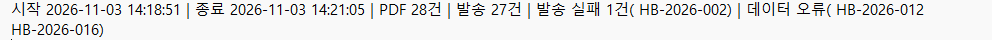
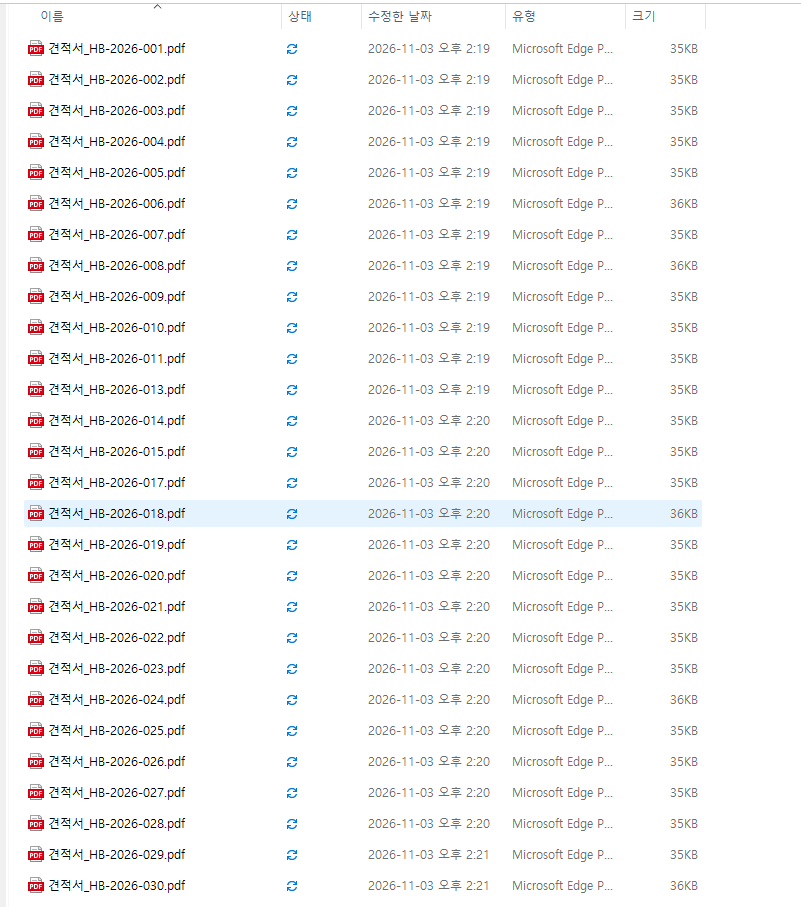
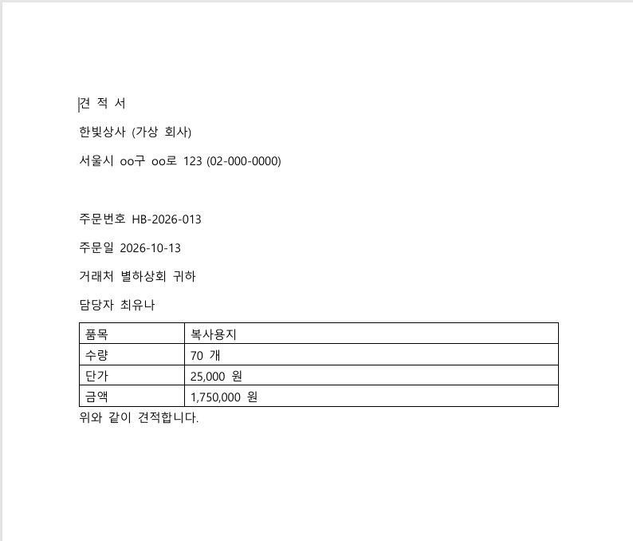

# 견적서 일괄 발행·메일 발송 자동화

주문 엑셀을 읽어 견적서 PDF를 만들고 거래처별 메일로 보내는 Power Automate Desktop 흐름입니다.
28건 처리 시간을 약 79분에서 약 3분 45초로 줄였습니다. (실패 건 제외, 자세한 기준은 아래 '효과' 참고)

## 문제
사무 업무를 하며 반복 문서를 만들 때, 글자 하나나 형식 하나만 틀려도 다시 작성해야 하는 경우가 많았습니다.
이 경험을 바탕으로 가상 회사 '한빛상사'의 견적서 발행 업무를 상황으로 잡았습니다.
- 주문마다 같은 값을 엑셀, Word, 메일에 옮겨 적어야 함
- 수작업 오류는 건마다 위치가 달라(주문번호, 숫자, 메일 주소 등) 어디가 틀렸는지 모든 칸을 확인해야 함
- 직접 측정한 3건에서도 Word 파일 첨부, 첨부 파일명 오류 2건이 발생함

## 해결
- 엑셀 값을 Word 양식에 자동으로 채워 PDF로 저장
- 주문번호로 파일 이름을 만들어 해당 건의 PDF를 메일에 첨부
- 데이터 오류와 발송 실패를 나눠 기록하고, 나머지 건은 계속 처리
- 양식이나 흐름의 오류는 전 건의 같은 칸에 나타남: 001의 주문번호가 틀리면 002, 003도 주문번호가 틀리므로, 그 칸의 원인만 고치고 샘플로 재검증 가능
- 엑셀 원본의 오타는 해당 건에만 나타나므로 입력 데이터 확인은 계속 필요

## 사용 기술
Power Automate Desktop, Excel, Word, Outlook

## 데이터 출처
- 직접 만든 가상 주문 데이터 30건 (실제 회사 데이터 미사용)
- 저장소에는 이메일을 `example.com`으로 바꾼 샘플만 공개
- 테스트 메일은 본인 소유 주소로만 발송

## 운영 기능
- 데이터 오류와 메일 발송 실패를 나눠서 기록
- 메일 발송 오류가 나도 다음 건을 계속 처리
- 실행 로그: 시작·종료 시각, PDF·발송·실패 건수

## As-Is / To-Be

```mermaid
flowchart TD
    subgraph ASIS["As-Is: 주문마다 손으로 반복"]
        A1["엑셀 파일 찾기 (첫 건만)"] --> A2["엑셀에서 주문 확인"]
        A2 --> A3["Word 양식 파일 찾기 (첫 건만)"]
        A3 --> A4["양식 복사 후 8칸 입력"]
        A4 --> A5["PDF로 저장"]
        A5 --> A6["메일 작성, PDF 첨부 후 발송"]
        A6 --> A7["다음 주문으로 반복"]
        A7 --> A8{"실패 건이 있나요?"}
        A8 -->|없음| A9["완료: 28건 약 79분"]
        A8 -->|있음| A10["담당자가 수정 처리"]
    end
    subgraph TOBE["To-Be: 실행과 검수만 사람이"]
        B1["담당자가 흐름 실행"] --> B2["엑셀 읽기, 데이터 검사"]
        B2 --> B3["Word 채우고 PDF 저장"]
        B3 --> B4["이메일 검사 후 발송"]
        B4 --> B5["실행 로그 기록"]
        B5 --> B6["담당자 결과 확인, 샘플 검수"]
        B6 --> B7{"실패 건이 있나요?"}
        B7 -->|없음| B8["완료: 28건 약 3분 45초"]
        B7 -->|있음| B9["담당자가 수정 처리"]
    end
```

## 실행 결과
가상 주문 30건을 처리한 결과입니다.

**실행 로그**: PDF 28건, 발송 27건, 발송 실패 1건, 데이터 오류 2건

**생성된 PDF 목록**: 데이터 오류인 HB-2026-012, HB-2026-016은 PDF를 만들지 않음

**견적서 PDF 예시**

## 효과 (실패 건을 제외한 28건 기준)
| 구분 | 28건 처리 시간 | 측정 방법 |
|---|---|---|
| 수작업 | 약 79분 | 3건 직접 측정 (첫 건 5분 18초 + 27건 × 2분 44초) |
| 자동화 | 약 3분 45초 | 실행 로그 2분 14초 + 샘플 5통 검수 1분 31초 |

- 월 300건을 28건씩 처리한다고 가정하면 월 약 13시간 절감
- 개발·유지보수 시간은 제외
- 수작업 측정 3건 중 2건에서 첨부 파일 실수 발생 (표본이 적어 참고용)

**시간 계산에서 제외한 항목**
- 실패 건 수정 처리: 두 방식 모두 사람이 처리하며 1건 처리와 비슷하게 걸림 (약 2분 44초 이상, 별도 측정 아님)
- 자동화는 실패 건을 목록과 로그로 알려줌

## 품질 검증
- 건수 대조: 입력 30건 = PDF 28건 + 데이터 오류 2건, 발송 27건 + 발송 실패 1건 = PDF 28건
- 샘플 검수에서 전 건 주문번호가 같은 오류를 발견해 양식을 수정하고 재검증

## 어려웠던 점과 배운 점
- 3건 테스트에서 변수를 글자로 입력해 조건이 작동하지 않아, 멈추지 않고 메일이 계속 발송됨 (테스트 주소라 외부 발송 없음)
- PDF와 메일 건수는 맞았지만, 샘플 검수에서 전 건의 주문번호가 같은 오류를 발견함. 원인은 Word 양식에 값이 직접 입력된 것이었음
- 실패 케이스 결과가 예상과 달라 확인해 보니, 테스트 데이터를 다른 주문에 넣어 둔 것이 원인이었음
- 배운 점: 건수 확인만으로는 부족하며, 데이터와 양식, 흐름을 실행 전에 함께 검증해야 함

## 한계와 개선점
- 수동 실행: 예약 실행에는 Power Automate Premium 또는 종량제 환경 필요
- 발송 이력이 없어 다시 실행하면 같은 메일이 다시 발송됨
- 형식은 맞지만 존재하지 않는 주소는 반송 메일로만 확인 가능

## 개선 아이디어 (미구현)
발송 전에 규칙 검사(양식, 필수값, 파일명과 PDF 내용 대조)로 1차 확인 → AI 에이전트로 규칙이 놓치는 내용 점검(개인정보 마스킹 후) → 사람이 샘플 검수와 발송 승인

## 참고: 발송 후 발견되는 오류
- 파일 형식이나 내용 오류를 발송 후에 발견하면 재처리에 더해 정정 안내와 거래처 대응이 필요함 (빈도 데이터가 없어 시간 계산에서 제외)
- 수작업은 보통 해당 건만 틀리지만, 자동화는 양식이나 흐름이 틀리면 전 건에 같은 오류가 퍼질 수 있음
- 현재 샘플 검수는 발송 후 단계이고 수신자는 테스트 주소뿐임. 실제 운영에서는 발송 전에 PDF 샘플을 검수하는 단계가 필요함